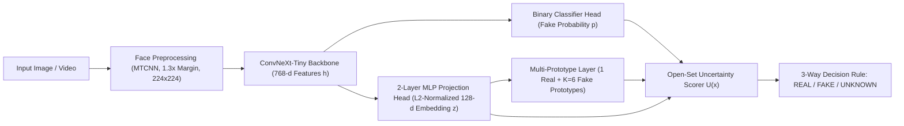

<!--
File: SPEC.md
Description: Technical specification and mathematical blueprint for the ZeroFake project.
Inputs: Read by AI coding assistants and developers before implementing preprocessing, model architectures, loss functions, training pipelines, and evaluation scripts.
Outputs: Provides exact formulas, tensor shapes, hyperparameters, decision rules, and evaluation matrices conforming to AGENTS.md.
-->

# ZeroFake — Technical Specification & Mathematical Blueprint

This document defines the exact Phase-1 technical blueprint for **ZeroFake: Zero-Day Deepfake Detection via Multi-Generator Contrastive Learning, Multi-Prototype Fake Representation, and Calibrated Open-Set Uncertainty**, in strict compliance with `AGENTS.md`.

---

## 1. System Pipeline (Sec 4)

The end-to-end ZeroFake pipeline transforms a raw image or video into a calibrated 3-way verdict (`REAL`, `FAKE`, or `UNKNOWN`):

### Stage-by-Stage Specification
1. **Input Image / Video & Face Preprocessing (`preprocessing/`)**:
   * **Video Frame Sampling**: Extract $N = 16$ evenly spaced frames per video using OpenCV.
   * **Face Detection & Alignment**: Use `MTCNN` (`facenet-pytorch`) on GPU/CPU to detect the primary face bounding box and landmarks.
   * **Bounding Box Expansion**: Expand the face bounding box by a **$1.3\times$ margin** to preserve critical boundary blending and peri-facial manipulation artifacts.
   * **Resizing & Normalization**: Resize cropped faces to **$224 \times 224 \times 3$** RGB images and normalize with ImageNet mean `(0.485, 0.456, 0.406)` and standard deviation `(0.229, 0.224, 0.225)`.
   * **Storage Format**: Package crops into a single `cropped_faces.zip` archive accompanied by `frames_manifest.csv` (`frame_path`, `video_id`, `identity_ids`, `label`, `generator`, `split`).
2. **Feature Extractor Backbone (`models/backbone.py`)**:
   * **Architecture**: Pretrained `convnext_tiny` from `timm` (`num_classes=0`, global average pooled output).
   * **Input Tensor**: $x \in \mathbb{R}^{B \times 3 \times 224 \times 224}$.
   * **Output Feature Vector**: $h = f_\theta(x) \in \mathbb{R}^{B \times 768}$.
3. **Projection Head (`models/projection_head.py`)**:
   * **Architecture**: 2-layer MLP (`Linear(768, 512)` $\rightarrow$ `BatchNorm1d(512)` $\rightarrow$ `GELU` $\rightarrow$ `Linear(512, 128)`) followed by $L_2$ normalization.
   * **Output Embedding**:
     $$z = \frac{g_\phi(h)}{\|g_\phi(h)\|_2} \in \mathbb{R}^{B \times 128}, \quad \|z\|_2 = 1$$
4. **Binary Classification Head (`models/classifier.py`)**:
   * **Architecture**: Linear classification layer (or lightweight MLP with dropout) operating on backbone features $h$ (or fused representation) outputting logit $s \in \mathbb{R}^{B \times 1}$ and fake probability:
     $$p = P(y = 1 \mid x) = \sigma(s) \in [0, 1]$$
     where $y = 0$ denotes **Real** and $y = 1$ denotes **Fake**.
5. **Multi-Prototype Layer (`models/prototype.py`)**:
   * **Learnable Prototype Bank**:
     * **1 Real Prototype**: $p_{\text{real}} \in \mathbb{R}^{128}$ ($L_2$-normalized).
     * **$K = 6$ Fake Prototypes**: $\{p_{\text{fake}, k}\}_{k=1}^{K} \in \mathbb{R}^{K \times 128}$ ($L_2$-normalized), capturing diverse manipulation families and artifact clusters.
   * **Cosine Distances**:
     $$d_{\text{real}}(z) = 1 - \langle z, p_{\text{real}} \rangle$$
     $$d_{\text{fake}}(z) = \min_{k \in \{1, \dots, K\}} \left(1 - \langle z, p_{\text{fake}, k} \rangle\right)$$
6. **Open-Set Uncertainty Scorer & 3-Way Output (`models/open_set.py`)**:
   * Combines prototype distance, predictive entropy, and out-of-distribution (OOD) feature distance into a calibrated uncertainty score $U(x)$ to output `REAL`, `FAKE`, or `UNKNOWN`.

---

## 2. Mathematical Losses (Sec 6)

During training, every mini-batch ($B = 64$) is constructed via a **Generator-Balanced Batch Sampler** containing **50% Real faces** ($y_i = 0$) and **50% Fake faces** ($y_i = 1$) evenly distributed across all seen training generators.

### 2.1 Binary Classification Loss ($\mathcal{L}_{\text{cls}}$ — `losses/classification.py`)
Standard Binary Cross-Entropy with Logits Loss over batch size $B$:
$$\mathcal{L}_{\text{cls}} = -\frac{1}{B} \sum_{i=1}^{B} \left[ y_i \log(p_i) + (1 - y_i) \log(1 - p_i) \right]$$

### 2.2 Multi-Generator Supervised Contrastive Loss ($\mathcal{L}_{\text{con}}$ — `losses/contrastive.py`)
Encourages all authentic faces to cluster tightly together and aligns fake representations across different training generators in $L_2$-normalized embedding space $z_i$ with temperature $\tau = 0.07$:
$$\mathcal{L}_{\text{con}} = \sum_{i=1}^{B} \frac{-1}{|P(i)|} \sum_{p \in P(i)} \log \frac{\exp(z_i \cdot z_p / \tau)}{\sum_{a \in A(i)} \exp(z_i \cdot z_a / \tau)}$$
* $A(i) = \{1, \dots, B\} \setminus \{i\}$ is the set of all non-self indices in the mini-batch.
* $P(i) = \{p \in A(i) : y_p = y_i\}$ is the set of positive samples sharing the same class label ($y \in \{0, 1\}$) across different source videos and training generators.

### 2.3 Multi-Prototype Distance Loss ($\mathcal{L}_{\text{proto}}$ — `losses/prototype_loss.py`)
Pulls Real embeddings toward $p_{\text{real}}$, pulls Fake embeddings toward their nearest Fake prototype $\min_k d(z_i, p_{\text{fake}, k})$, separates opposite-class prototypes by a margin $m = 0.5$, and regularizes the $K = 6$ fake prototypes to remain diverse (non-collapsed):
$$\mathcal{L}_{\text{proto}} = \mathcal{L}_{\text{pull}} + \mathcal{L}_{\text{sep}} + \lambda_{\text{div}} \mathcal{L}_{\text{div}}$$
where:
* **Pull & Margin Separation**:
  $$\mathcal{L}_{\text{pull}} + \mathcal{L}_{\text{sep}} = \frac{1}{B} \sum_{i=1}^{B} \left[ (1 - y_i)\Big(d_{\text{real}}(z_i) + \max(0, m - d_{\text{fake}}(z_i))\Big) + y_i\Big(d_{\text{fake}}(z_i) + \max(0, m - d_{\text{real}}(z_i))\Big) \right]$$
* **Fake Prototype Diversity Regularizer** (prevents all $K$ fake prototypes from collapsing onto a single vector):
  $$\mathcal{L}_{\text{div}} = \frac{2}{K(K-1)} \sum_{j=1}^{K} \sum_{k=j+1}^{K} \max\left(0, \langle p_{\text{fake}, j}, p_{\text{fake}, k} \rangle\right)$$

### 2.4 Total Combined Objective ($\mathcal{L}_{\text{total}}$)
$$\mathcal{L}_{\text{total}} = \mathcal{L}_{\text{cls}} + \lambda_1 \mathcal{L}_{\text{con}} + \lambda_2 \mathcal{L}_{\text{proto}}$$
* **Default Phase-1 Weights**: $\lambda_1 = 0.5$, $\lambda_2 = 0.2$ (yielding $\mathcal{L}_{\text{total}} = \mathcal{L}_{\text{cls}} + 0.5\mathcal{L}_{\text{con}} + 0.2\mathcal{L}_{\text{proto}}$).
* **Ablation Mode Overrides**:
  * `baseline` (Config A): $\lambda_1 = 0.0, \lambda_2 = 0.0$
  * `contrastive` (Config B): $\lambda_1 = 0.5, \lambda_2 = 0.0$
  * `single_proto` (Config C): $\lambda_1 = 0.5, \lambda_2 = 0.2$ with $K = 1$ Fake prototype
  * `zerofake` (Config D/E): $\lambda_1 = 0.5, \lambda_2 = 0.2$ with $K = 6$ Fake prototypes

---

## 3. Open-Set Decision Rule (Sec 5.6)

To handle unseen zero-day generators and ambiguous/degraded inputs without overconfident misclassifications, ZeroFake computes a calibrated composite uncertainty score $U(x)$.

### 3.1 Three Raw Uncertainty Components
1. **Nearest-Prototype Cosine Distance ($D_{\text{prototype}}(x)$)**:
   Measures how far embedding $z$ lies from its closest known prototype (either Real or the nearest of the $K$ Fake prototypes):
   $$D_{\text{prototype}}(x) = \min\Big(d_{\text{real}}(z),\; d_{\text{fake}}(z)\Big)$$
2. **Predictive Shannon Entropy ($H(p(y \mid x))$)**:
   Measures classifier boundary ambiguity from predicted fake probability $p = P(y=1 \mid x)$ (clipped to $[\epsilon, 1-\epsilon]$ with $\epsilon = 10^{-7}$):
   $$H(p(y \mid x)) = -\frac{1}{\ln 2} \Big[ p \ln(p) + (1 - p) \ln(1 - p) \Big] \in [0, 1]$$
3. **Out-of-Distribution Feature Distance ($S_{\text{OOD}}(x)$)**:
   Measures the Mahalanobis (or diagonal shrinkage-regularized covariance) distance of embedding $z$ (or feature $h$) to the closest training class cluster distribution $\{(\mu_c, \Sigma_c)\}_{c \in \{\text{real}, \text{fake}\}}$ fitted on the training set:
   $$S_{\text{OOD}}(x) = \min_{c} \sqrt{(z - \mu_c)^\top (\Sigma_c + \delta I)^{-1} (z - \mu_c)}$$

### 3.2 Strict Validation-Only Calibration & Z-Score Normalization
In strict compliance with **Rule 3 (`AGENTS.md`)**, normalization statistics and thresholds are calibrated **exclusively on the `val` split** (never on `test_unseen` or `Celeb-DF v2`):
1. Compute raw scores $\{D_{\text{prototype}}(x_i), H(p(y \mid x_i)), S_{\text{OOD}}(x_i)\}$ for all $x_i \in \mathcal{D}_{\text{val}}$.
2. Fit validation means $(\mu_D, \mu_H, \mu_S)$ and standard deviations $(\sigma_D, \sigma_H, \sigma_S)$ on $\mathcal{D}_{\text{val}}$ and compute z-score normalized terms:
   $$\tilde{D}(x) = \frac{D_{\text{prototype}}(x) - \mu_D}{\sigma_D + \epsilon}, \quad \tilde{H}(x) = \frac{H(p(y \mid x)) - \mu_H}{\sigma_H + \epsilon}, \quad \tilde{S}(x) = \frac{S_{\text{OOD}}(x) - \mu_S}{\sigma_S + \epsilon}$$
3. Combine with weighting coefficients $\alpha, \beta, \gamma$ (default $\alpha = \frac{1}{3}, \beta = \frac{1}{3}, \gamma = \frac{1}{3}$ or `[0.4, 0.3, 0.3]`):
   $$U(x) = \alpha \tilde{D}(x) + \beta \tilde{H}(x) + \gamma \tilde{S}(x)$$
4. **Rejection Threshold Calibration ($\tau_{\text{reject}}$)**:
   Set $\tau_{\text{reject}}$ to the **95th percentile** of $\{U(x_i)\}_{x_i \in \mathcal{D}_{\text{val}}}$ so that **95% of validation samples are retained** (5% validation rejection rate).

### 3.3 Combined Class Evidence & 3-Way Decision Rule
Define the combined fake likelihood score $E_{\text{fake}}(x) \in [0, 1]$ blending classifier probability $p$ and relative prototype affinity:
$$p_{\text{proto}}(x) = \frac{\exp(-d_{\text{fake}}(z) / \tau_p)}{\exp(-d_{\text{fake}}(z) / \tau_p) + \exp(-d_{\text{real}}(z) / \tau_p)}, \quad E_{\text{fake}}(x) = 0.5\,p + 0.5\,p_{\text{proto}}(x)$$

The final 3-way prediction $\hat{y}_{\text{open}}(x)$ is:
$$\hat{y}_{\text{open}}(x) = \begin{cases} \text{\texttt{UNKNOWN}} & \text{if } U(x) > \tau_{\text{reject}} \\ \text{\texttt{FAKE}} & \text{if } U(x) \le \tau_{\text{reject}} \text{ and } E_{\text{fake}}(x) \ge 0.5 \\ \text{\texttt{REAL}} & \text{if } U(x) \le \tau_{\text{reject}} \text{ and } E_{\text{fake}}(x) < 0.5 \end{cases}$$

---

## 4. Evaluation & Ablation Matrix (Sec 8–11)

### 4.1 Leave-One-Generator-Out (LOGO) & Leakage-Free Partition Protocol
* **Dataset**: FaceForensics++ (`c23` compression) comprising 1,000 Real videos and 4 manipulation methods (`Deepfakes`, `Face2Face`, `FaceSwap`, `NeuralTextures`).
* **Connected-Component Identity Graph (`preprocessing/create_splits.py`)**:
  * Parse both source and target actor IDs from manipulated filenames (e.g., `000_003.mp4` links identity `000` and identity `003`).
  * Group connected components of identities so no actor's face ever appears in more than one split (`train`, `val`, `test_closed`, `test_unseen`).
  * Run an automated programmatic assertion verifying zero identity or video overlap across splits before writing `splits.json`.
* **LOGO Split Breakdown**:
  * **`test_unseen` (Held-Out Zero-Day Generator)**: 100% of videos from one held-out generator (default: `NeuralTextures`; bonus LOGO run: `FaceSwap`) paired with test-partition Real videos.
  * **Seen Generators (`Deepfakes`, `Face2Face`, `FaceSwap`) + `Real`**: Partitioned by identity connected-components into:
    * `train`: **80%**
    * `val`: **10%** (used for best checkpoint selection by ROC-AUC and calibrating $U(x)$ and $\tau_{\text{reject}}$)
    * `test_closed`: **10%** (known-generator in-distribution test set)

### 4.2 Cross-Dataset Generalization Benchmark
* **Dataset**: **Celeb-DF v2** (real celebrity videos and high-quality deepfake syntheses with unseen lighting, compression, and actors).
* **Rule**: Evaluated strictly zero-shot using the FaceForensics++-trained model and `val`-calibrated threshold $\tau_{\text{reject}}$ without any fine-tuning or recalibration.

### 4.3 Robustness Stress-Test Perturbations
Evaluate closed-set and unseen-generator detection under 5 real-world degradation conditions:
1. **JPEG Compression (Quality 75)**: Re-encode face crops at JPEG quality 75.
2. **JPEG Compression (Quality 50)**: Heavy social-media compression at JPEG quality 50.
3. **Gaussian Blur**: Apply $5 \times 5$ Gaussian kernel ($\sigma = 1.5$).
4. **Gaussian Noise**: Add zero-mean Gaussian pixel noise ($\sigma = 0.05$ in normalized `[0, 1]` range).
5. **Low-Resolution Downsampling**: Downsample face crop to $112 \times 112$ and bilinearly upsample back to $224 \times 224$.

### 4.4 Five-Configuration Ablation Matrix (Configs A–E)

| Config | Mode Flag | Backbone | Contrastive ($\mathcal{L}_{\text{con}}$) | Prototypes ($\mathcal{L}_{\text{proto}}$) | Open-Set Uncertainty ($U(x)$) | Scientific Purpose |
| :--- | :--- | :--- | :---: | :---: | :---: | :--- |
| **Config A** | `baseline` | ConvNeXt-Tiny | No ($\lambda_1=0$) | None ($\lambda_2=0$) | Disabled | Standard binary cross-entropy baseline |
| **Config B** | `contrastive` | ConvNeXt-Tiny | Yes ($\lambda_1=0.5$) | None ($\lambda_2=0$) | Disabled | Quantifies gain from multi-generator contrastive clustering |
| **Config C** | `single_proto` | ConvNeXt-Tiny | Yes ($\lambda_1=0.5$) | 1 Real + $K=1$ Fake | Disabled | Tests single-cluster fake assumption vs. multi-modal fakes |
| **Config D** | `zerofake` (Closed) | ConvNeXt-Tiny | Yes ($\lambda_1=0.5$) | 1 Real + $K=6$ Fake | Disabled (Forced Binary) | Quantifies gain from $K=6$ diverse fake prototypes at 100% coverage |
| **Config E** | `zerofake` (Full) | ConvNeXt-Tiny | Yes ($\lambda_1=0.5$) | 1 Real + $K=6$ Fake | Enabled ($\tau_{\text{reject}}$ @ 95% val) | Full ZeroFake system with calibrated `UNKNOWN` rejection |

### 4.5 Mandatory Detection & Open-Set Rejection Metrics (`results/results_summary.csv`)
1. **ROC-AUC**: Area Under the Receiver Operating Characteristic curve (computed over all samples using continuous score $E_{\text{fake}}(x)$).
2. **Equal Error Rate (EER)**: Error rate at the threshold where False Acceptance Rate (FAR) equals False Rejection Rate (FRR).
3. **Macro / Binary F1-Score**: Harmonic mean of Precision and Recall at the standard operating threshold.
4. **Selective Accuracy**: Classification accuracy computed strictly over accepted samples where $U(x) \le \tau_{\text{reject}}$ ($\hat{y}_{\text{open}}(x) \neq \text{\texttt{UNKNOWN}}$).
5. **Coverage (% Accepted)**: Percentage of test samples retained after open-set filtering ($\frac{1}{N}\sum_{i=1}^N \mathbb{I}[U(x_i) \le \tau_{\text{reject}}] \times 100\%$).
6. **Known-Real Rejection Rate**: Percentage of authentic `Real` test samples flagged as `UNKNOWN`.
7. **Known-Fake / Unseen-Fake Rejection Rate**: Percentage of `Fake` test samples (reported separately for known vs. unseen generators) flagged as `UNKNOWN`.

### 4.6 Publication-Quality Visual Deliverables (`results/plots/`)
1. **ROC Curves (`roc_comparison.png`)**: Baseline (Config A) vs. Full ZeroFake (Config D/E) on `test_unseen` and `Celeb-DF v2`.
2. **Confusion Matrices (`confusion_matrices.png`)**: Standard 2-way and Open-Set 3-way (`REAL`, `FAKE`, `UNKNOWN`) confusion matrices.
3. **t-SNE Embedding Cluster Plot (`tsne_prototypes.png`)**: 2D projection of 128-d embeddings $z$ showing `Real` embeddings, different fake generators, and the learned 1 Real + 6 Fake prototype stars.
4. **Grad-CAM Facial Heatmaps (`gradcam_heatmaps.png`)**: Side-by-side spatial attention overlays on the final ConvNeXt-Tiny stage highlighting peri-orbital, mouth, or blending boundary artifacts.
